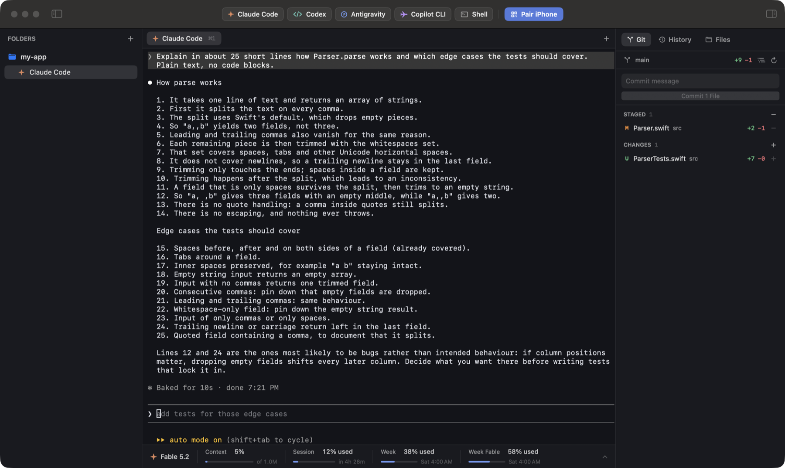
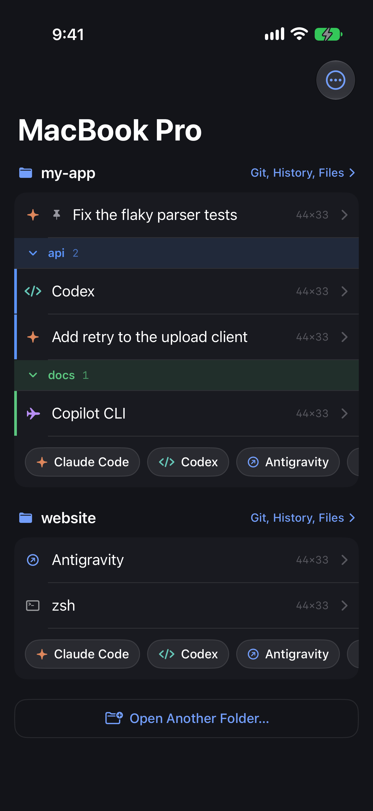
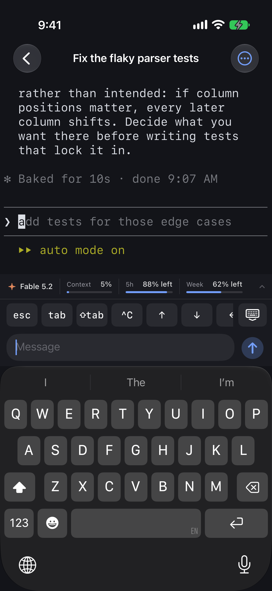
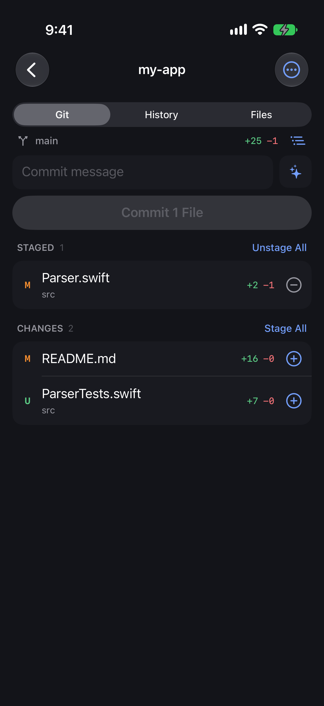
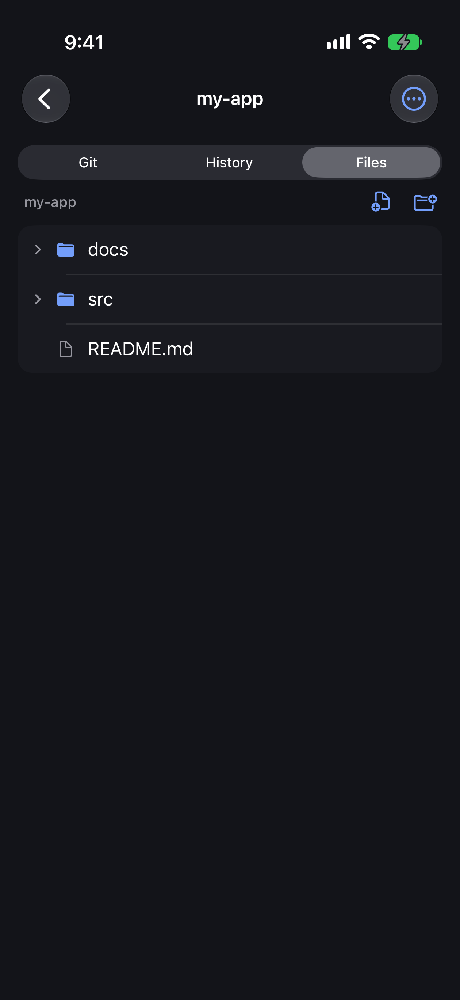

<div align="center">

# AgentTerm

**A native macOS terminal for coding agents, with an iPhone remote.**

Run Claude Code, Codex, Antigravity and GitHub Copilot CLI side by side on your Mac,
and pick up any session from your iPhone.

[](https://github.com/manhpham90vn/AgentTerm/actions/workflows/ci.yml)
[](https://github.com/manhpham90vn/AgentTerm/releases)
[](LICENSE)

[](https://discord.gg/Ksagmsd6j)



</div>

AgentTerm runs each agent in a real terminal owned by a small host daemon, so
sessions keep running when the window is closed and your iPhone can attach to
them over [Tailscale](https://tailscale.com).

> **Status: beta.** Use matching versions of the Mac and iPhone apps; see [Compatibility](#compatibility).

## Features

- **Every agent, one click.** Starts any agent CLI installed on your Mac, in a
  real terminal.
- **Sessions that keep running.** Close the window or quit the app; they are
  still there, and the app can stay in the menu bar.
- **Tabs you arrange.** Sessions, files and diffs in one strip: drag to
  reorder, pin, and group with a name and a color.
- **Git, files and history** of each project folder next to the terminal:
  stage and commit, edit files, preview Markdown and Mermaid, resume a past
  conversation.
- **Usage at a glance.** Model, context and what your account has left, with
  reset times, for Claude Code, Codex, Antigravity and Copilot CLI.
- **Handoff.** Pass a conversation's work to another agent when one runs out
  of quota, in the same folder or another one.
- **iPhone remote.** Pair with a QR code and get the same sessions, folders,
  git, files and usage on your phone, with a key bar and a compose field made
  for prompts. Pins, groups and order stay in sync with the Mac.

<p>




</p>

## Install

**Mac, with [Homebrew](https://brew.sh):**

```sh
brew tap manhpham90vn/tap
brew trust manhpham90vn/tap     # Homebrew 7 and later: a tap outside Homebrew's own has to be trusted first
brew install --cask agentterm
```

`brew upgrade --cask agentterm` gets a newer version later.

**Mac, by hand:** download the latest `AgentTerm-<version>.dmg` from
[Releases](https://github.com/manhpham90vn/AgentTerm/releases), open it and
drag AgentTerm to Applications.

Either way the app is signed and notarized. It is built for Apple silicon.

**iPhone:** [join the beta on TestFlight](https://testflight.apple.com/join/Ny2JKHUp).

Requirements: macOS 14 or later, iOS 17 or later, and
[Tailscale](https://tailscale.com) on both devices to reach the Mac from
outside your desk. At least one agent CLI installed on the Mac.

### Getting started

1. Open AgentTerm on the Mac and add a project folder.
2. Start an agent with its button in the toolbar.
3. Click **Pair iPhone**, and scan the code with the iPhone app.

macOS asks for permissions on behalf of what the agents do (files, automation,
screen recording and so on). **Settings → Permissions** lists them and where to
grant each.

## Compatibility

The Mac and iPhone apps talk over a versioned protocol, so use versions from
the same row.

| Mac app | iPhone app | Protocol |
|---|---|---|
| 0.2.x | 0.2.x | 5 |
| 0.1.x | 0.1.x | 4 |

Versions from different rows are not supported together. Update both apps
when you update one.

## Security and privacy

The daemon listens only on `127.0.0.1` and the Mac's Tailscale address. An
iPhone pairs with a one-time code and gets a token of its own, which the Mac
can revoke. To show account usage, AgentTerm reads each agent's sign-in on
your Mac and sends it only to the service that issued it
(`agenttermd --no-account-usage` turns that off).

The released apps can send crash reports (only if you say yes) and counts of
which features are used (one switch turns it off) through Firebase; never
terminal content, prompts, file names or folders. A build from source sends
nothing. AgentTerm has no server of its own. Details
in [SECURITY.md](SECURITY.md) and [PRIVACY.md](PRIVACY.md).

## Documentation

- [docs/SPEC.md](docs/SPEC.md): everything the product does, and the roadmap
- [docs/DEVELOPMENT.md](docs/DEVELOPMENT.md): build from source, tests, code layout, contributing
- [docs/DESIGN.md](docs/DESIGN.md): architecture and protocol
- [docs/RELEASE.md](docs/RELEASE.md): how releases are made
- [SUPPORT.md](SUPPORT.md): getting help
- [Discord](https://discord.gg/Ksagmsd6j): questions, ideas and news

## License

[MIT](LICENSE). Third-party software is listed in
[THIRD_PARTY_NOTICES.md](THIRD_PARTY_NOTICES.md).
